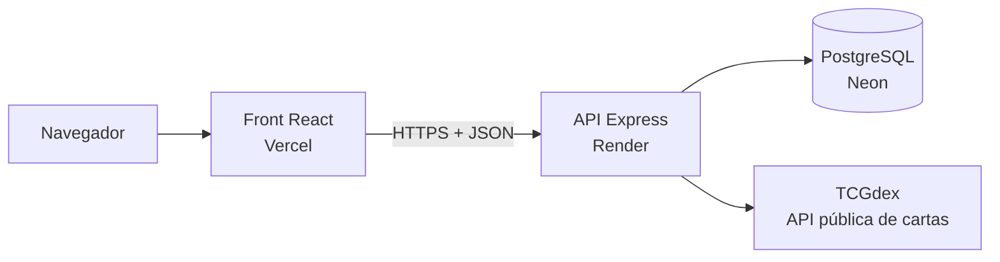
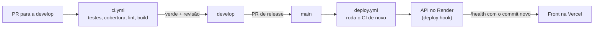

# PokeBox

Plataforma para colecionadores de cartas **Pokémon TCG**: organizar a coleção, montar a wishlist, ver a coleção pública de outros colecionadores e **trocar cartas** entre si.

O PokeBox é **só de trocas**. Não existe venda, preço de venda nem pagamento. O preço que aparece nas cartas é uma **referência de mercado** (vinda da TCGdex), útil para comparar o que se dá e o que se recebe numa troca.

Projeto em equipe do curso **Geração Tech**.

O PokeBox é um projeto de estudo, sem ligação com a The Pokémon Company, Nintendo ou Game Freak.

[](https://github.com/GeracaoBezerra/PokeBox/actions/workflows/ci.yml)
[](https://github.com/GeracaoBezerra/PokeBox/actions/workflows/deploy.yml)

| | Endereço |
|---|---|
| App | https://poke-box-gt.vercel.app |
| API | https://pokebox-api.onrender.com |
| Documentação da API (Swagger) | https://pokebox-api.onrender.com/docs |
| Board | https://github.com/orgs/GeracaoBezerra/projects/1 |

## Para a avaliação

Onde está cada critério do projeto final:

| Critério | Onde ver |
|---|---|
| POO e SOLID no código | [`docs/arquitetura.md`](docs/arquitetura.md): diagramas, tabela SOLID com arquivos, padrões de projeto e pontos fracos |
| Docker Compose | [Como rodar](#como-rodar), [`docs/desenvolvimento.md`](docs/desenvolvimento.md) e [`docs/processo.md`](docs/processo.md#docker-compose) |
| Pirâmide de testes | [Testes](#testes) e [`docs/testes.md`](docs/testes.md): unidade, integração, front e E2E, com cobertura mínima na CI |
| CI/CD | [Deploy](#deploy), [`docs/deploy-e-producao.md`](docs/deploy-e-producao.md) e [`docs/processo.md`](docs/processo.md#github-actions) |
| Logs, traces e performance | [`docs/observabilidade-e-performance.md`](docs/observabilidade-e-performance.md) |
| Decisões técnicas e o que ficou de fora | [`docs/decisoes/`](docs/decisoes/README.md) |
| Uso de IA | [`docs/ia.md`](docs/ia.md) |
| Organização do time | [`docs/processo.md`](docs/processo.md): board, branches, revisão de PR e proteção das branches |
| Limitações e próximos passos | [Limitações, dívidas e próximos passos](#limitações-dívidas-e-próximos-passos) |

Números da bancada final (23/11, [#60](https://github.com/GeracaoBezerra/PokeBox/issues/60)): 927 testes de unidade e 173 de integração no backend, com 98,3% das linhas cobertas; 364 testes no front (68% das linhas); 11 testes E2E. O roteiro manual passou inteiro, com duas falhas pequenas que viraram as issues #228 e #229.

## Sumário

- [Para a avaliação](#para-a-avaliação)
- [Stack](#stack)
- [Arquitetura](#arquitetura)
- [Como rodar](#como-rodar)
- [Usuários de teste (seed)](#usuários-de-teste-seed)
- [Testes](#testes)
- [Deploy](#deploy)
- [Logs, traces e performance](#logs-traces-e-performance)
- [API](#api)
- [Regras de negócio](#regras-de-negócio)
- [Limitações, dívidas e próximos passos](#limitações-dívidas-e-próximos-passos)
- [Status do projeto](#status-do-projeto)
- [Como contribuir](#como-contribuir)
- [Documentação completa](#documentação-completa)

## Stack

| Parte | Tecnologia |
|---|---|
| Backend | Node.js (LTS), TypeScript 6, Express 5, Prisma 7 (`@prisma/adapter-pg`), zod 4, JWT, bcrypt |
| Banco | PostgreSQL 17 (local) e 18 (Neon, produção) |
| Frontend | React 19, Vite, React Router, axios |
| Dados das cartas | API pública [TCGdex](https://tcgdex.dev), com cache no banco e uma cópia resumida de todas as cartas para a busca (`pg_trgm` + `unaccent`) |
| Testes | Jest com ts-jest (backend), Vitest com jsdom, Testing Library e MSW (frontend), Cypress com Testing Library (E2E) |
| Documentação da API | Swagger em `/docs` |
| Infra | Docker Compose (modo dev e modo produção), GitHub Actions (CI e deploy), Render (API), Neon (banco), Vercel (front) |

## Arquitetura



No backend, cada requisição passa por routes → controllers → services → repositories, e as regras de negócio puras ficam em `utils/*Rules.ts`. Diagrama das camadas, POO, SOLID com exemplos e padrões de projeto: [`docs/arquitetura.md`](docs/arquitetura.md).

```
backend/    API em TypeScript (Express, Prisma); docs/db.md tem o modelo de dados
frontend/   app React (Vite)
e2e/        testes E2E com Cypress
docs/       arquitetura, decisões, processo, IA e guias detalhados
.github/    CI, E2E, deploy e sync do catálogo
```

Estrutura completa e o backend em TypeScript (build, variáveis validadas, raiz de composição): [`docs/desenvolvimento.md`](docs/desenvolvimento.md).

## Como rodar

Precisa de Docker e Docker Compose (e Node.js LTS para rodar os testes fora do container).

```bash
cp .env.example .env
```

Preencha o `.env`: banco, `JWT_SECRET` com 16 caracteres ou mais e as senhas do seed (`SEED_ADMIN_PASSWORD` e `SEED_DEMO_PASSWORD`). Exemplo completo e o que é cada variável em [`docs/desenvolvimento.md`](docs/desenvolvimento.md#variáveis-de-ambiente).

```bash
docker compose up -d --build
```

No Compose local, o backend espera o PostgreSQL ficar saudável, aplica as migrations e, **só se o banco estiver vazio** (nenhum usuário), roda o seed antes de iniciar a API (`npm run db:seed-if-empty`). Na primeira subida, então, preencha antes `SEED_ADMIN_PASSWORD` e `SEED_DEMO_PASSWORD` no `.env`: sem elas o seed para, diz o que falta e o backend não sobe. Nas subidas seguintes o log mostra `Seed pulado: o banco já tem N usuário(s)` e nada é mexido, então os testes feitos à mão (uma oferta aceita, um anúncio fechado) continuam lá e o backend sobe mesmo sem as senhas no `.env`. Para rodar o seed de novo, à mão: `make seed` (ou `cd backend && npm run db:seed`).

| Serviço | Endereço |
|---|---|
| Frontend | http://localhost:5173 |
| API | http://localhost:3000 |
| Swagger | http://localhost:3000/docs |
| Saúde da API | http://localhost:3000/health |
| PostgreSQL | `localhost:5432` |

Outros jeitos de rodar (backend e front fora do Docker, modo produção local com `make prod-up`), banco do zero e o sync do catálogo de cartas: [`docs/desenvolvimento.md`](docs/desenvolvimento.md).

## Usuários de teste (seed)

As senhas não ficam no repositório: vêm do `.env`. `SEED_ADMIN_PASSWORD` é a do `admin`; `SEED_DEMO_PASSWORD` é a de todos os outros usuários. As duas são obrigatórias, têm de 8 a 72 caracteres e precisam ser diferentes; sem elas o seed para e diz o que falta. Peça os valores ao time ou escolha os seus no seu `.env`. Rodar o seed de novo aplica as senhas atuais do `.env` a todos os usuários do seed.

Itens de coleção contados depois das trocas que o seed faz:

| Usuário | E-mail | Papel | Cidade | O que tem |
|---|---|---|---|---|
| `admin` | `admin@pokebox.dev` | ADMIN | | nada na coleção; serve para a moderação (há um anúncio do `gary` bloqueado) |
| `ash` | `ash@pokebox.dev` | USER | São Paulo/SP | 13 itens: Charizard holo 1ª edição (anunciado), Pikachus, Ultra Ball (4), Furret e Lightning Energy (privados); trocou o Pikachu VMAX anunciado por 3 Eevee do `gary` (troca concluída) |
| `misty` | `misty@pokebox.dev` | USER | Rio de Janeiro/RJ | 13 itens: Blastoise holo e Gyarados (anunciados), Greninja ex (anúncio pausado), Mew ex holo, Fire Energy (10), cartas de água; troca concluída com o `brock` (3 Magikarp pelo Garchomp ex) |
| `brock` | `brock@pokebox.dev` | USER | Belo Horizonte/MG | 18 itens: Palkia, Garchomp ex, Snorlax VMAX, Iono (anunciados); trocas concluídas com a `erika` e com a `misty` (o Garchomp ex anunciado) e uma troca **aberta** com a `cynthia` |
| `gary` | `gary@pokebox.dev` | USER | Curitiba/PR | 19 itens: vários Charizard (anunciados, um **bloqueado** pelo admin); trocas concluídas com a `cynthia` e com o `ash` (3 Eevee pelo Pikachu VMAX) |
| `erika` | `erika@pokebox.dev` | USER | Porto Alegre/RS | 15 itens: Venusaur, Celebi V, Sylveon VMAX (anunciados), Nest Ball (pausado); troca em andamento com o `brock`, já confirmada por ela |
| `dawn` | `dawn@pokebox.dev` | USER | Recife/PE | 10 itens, todos **privados**: o perfil público dela aparece vazio |
| `cynthia` | `cynthia@pokebox.dev` | USER | Florianópolis/SC | 22 itens raros: Umbreon VMAX alt art, Lugia 1ª edição, Mew ex dourado (anunciados); troca aberta com o `brock` esperando ela aceitar |
| `lance` | `lance@pokebox.dev` | USER | Salvador/BA | conta **desativada**: não entra, o perfil dá 404, o anúncio dele some da vitrine e as cartas dele não contam nas oportunidades da wishlist |

O seed roda sozinho na primeira subida, pode rodar de novo sem duplicar nada (`make seed`) e funciona sem internet. O que ele cria e como testar pelo Swagger: [`docs/desenvolvimento.md`](docs/desenvolvimento.md#seed).

## Testes

| Andar da pirâmide | Ferramenta | Quantidade (23/11) | Comando |
|---|---|---|---|
| E2E | Cypress | 11 | `make e2e` |
| Front | Vitest + Testing Library + MSW | 364 | `cd frontend && npm test` |
| Integração (backend) | Jest + Supertest + PostgreSQL real | 173 | `make test-int` |
| Unidade (backend) | Jest | 927 | `cd backend && npm test` |

Cobertura: 98,3% das linhas no backend (mínimo de 95% na CI) e 68% no front (mínimo de 40%). Por que cada ferramenta: [decisão sobre testes](docs/decisoes/0009-testes.md). Como a IA ajudou a escrever e conferir os testes: [`docs/ia.md`](docs/ia.md).

Como rodar cada tipo, o que cada arquivo cobre e a cobertura por métrica: [`docs/testes.md`](docs/testes.md).

## Deploy



| Peça | Onde | Como chega lá |
|---|---|---|
| Banco PostgreSQL | Neon | as migrations rodam sozinhas quando a API sobe; o seed roda uma vez, à mão; o catálogo da busca roda uma vez à mão depois do deploy e toda semana pelo GitHub Actions |
| API | Render, com o Dockerfile de `backend/` (estágio `prod`) | o pipeline chama o deploy hook do Render |
| Front | Vercel, pasta `frontend/` | o pipeline publica com a CLI da Vercel |

O deploy só sai com os testes verdes, a API sobe primeiro e o front só é publicado quando o `/health` responde com o commit novo. Detalhes: [`docs/deploy-e-producao.md`](docs/deploy-e-producao.md).

## Logs, traces e performance

- Logs em JSON com pino; cada resposta traz um `x-request-id` que acha a linha no log.
- `GET /health` (sem banco) e `GET /health/ready` (com banco).
- Traces com OpenTelemetry: Jaeger local (`make traces`) e Grafana Cloud em produção.
- Performance: gzip, helmet, índices, paginação, `Cache-Control` e limite de tentativas no login, com medições antes e depois.

Detalhes e números: [`docs/observabilidade-e-performance.md`](docs/observabilidade-e-performance.md).

## API

Todas as rotas estão no Swagger (`/docs` da API, [produção](https://pokebox-api.onrender.com/docs)). Toda resposta segue `{ success: true, data }` ou `{ success: false, error, details }`. Lista das rotas, códigos de status e paginação: [`docs/api.md`](docs/api.md).

## Regras de negócio

RN-01 a RN-12: como cada uma funciona em [`docs/regras.md`](docs/regras.md).

Onde ver cada regra:

| Regra | Backend | Tela | Como demonstrar |
|---|---|---|---|
| RN-01 | `CollectionService`, tabela `Card` | Detalhe da carta e botão Tenho no catálogo | O `ash` adiciona a mesma carta duas vezes: `Card` continua com uma linha e a quantidade soma |
| RN-02 | `utils/collectionRules.ts` | Minha coleção | Com o token da `misty`, `PATCH /collection/<item do ash>` → 403 |
| RN-03 | `utils/collectionRules.ts`, CHECK no banco | Minha coleção | Quantidade -1 → 400; `UPDATE` direto no SQL com valor negativo é barrado pela CHECK |
| RN-04 | `WishlistService` | Wishlist (`/procuro`) | A `misty` vê "1 colecionador tem esta carta" no Charizard e "Ninguém tem ainda" no Pineco |
| RN-05 | `utils/listingRules.ts`, `ListingService` | Minha coleção (Anunciar), Meus anúncios (Novo anúncio) | Anunciar mais do que o disponível → erro "Quantidade acima do que você tem" |
| RN-06 | `utils/offerRules.ts`, `OfferService` | Detalhe do anúncio, Propostas | Ofertar no próprio anúncio não mostra o formulário; oferta repetida → 409 |
| RN-07 | `TradeService`, `utils/tradeRules.ts`, Unit of Work | Trocas | `brock` confirma a troca do Venusaur (a `erika` já confirmou) e as cartas mudam de dono nas duas coleções |
| RN-08 | `TradeOpener`, `SELECT ... FOR UPDATE` | Trocas, Minha coleção (Reservada) | O Dialga do `brock` aparece com Reservada 1 e o Apagar desligado com "Está numa troca em andamento" |
| RN-09 | `DbCachedCatalog`, tabela `Card` | Coleção e wishlist mostram nome, imagem e preço | Com a TCGdex fora do ar, coleção e detalhe de carta continuam respondendo |
| RN-10 | `ProfileService` | Perfil público (`/u/:username`) | `/u/ash` não mostra o Furret (privado); `/u/dawn` mostra "Nenhuma carta pública." |
| RN-11 | `CollectionService`, `TradeService` | Wishlist (Já consegui), catálogo (Tenho) | A `misty` adiciona à coleção uma carta da wishlist e ela sai da wishlist |
| RN-12 | `utils/wishlistRules.ts` | Detalhe da carta, catálogo (Quero) | A `misty` não consegue pôr na wishlist o Mew ex que já tem (botão desligado; API → 409) |

### Adaptação: só trocas

O enunciado previa anúncios de venda e de troca. **O time decidiu que o PokeBox é só de trocas** (sem venda nem pagamento). Por isso:

- o anúncio não tem tipo nem preço;
- a oferta diz **quais cartas da coleção** o proponente dá em troca;
- a RN-05 vira "só anuncia o que tem disponível para troca".

## Limitações, dívidas e próximos passos

### Limitações conhecidas

- No plano gratuito do Render, a API dorme depois de 15 minutos sem uso, e a primeira chamada seguinte leva cerca de 2 minutos (a imagem sobe e roda o `prisma migrate deploy` antes de atender). Para isso não acontecer durante a avaliação, um monitor externo gratuito (UptimeRobot) chama `GET /health` a cada 5 minutos e avisa por e-mail se a API cair. Antes isso era um workflow agendado no GitHub Actions, a cada 10 minutos; ele foi removido porque o GitHub atrasa e descarta agendamentos quando a fila está cheia, e na prática rodou 1 vez em 5 horas. Não custa nada: um serviço ligado o mês todo cabe nas 750 h grátis do Render (não criar outro serviço grátis na mesma conta) e o `/health` não consulta o banco, então o Neon continua dormindo. O cache de cartas em memória some quando ela dorme; o cache no banco continua.
- Em produção, nenhuma senha do seed é pública. A do `ash` e da `misty` (`SEED_DEMO_PASSWORD`) é passada a quem for avaliar fora do GitHub; a do `admin` (`SEED_ADMIN_PASSWORD`) fica só com o time. O login e o cadastro param depois de 20 tentativas sem sucesso para o mesmo e-mail em 15 minutos.
- Neon gratuito: 0,5 GB e só 6 horas de histórico para restaurar o banco.
- As contas de Vercel, Render e Neon estão em nome de membros do time.
- Token JWT no `localStorage`: um script injetado na página (XSS) poderia lê-lo. Não há refresh token: a sessão vale 1 dia ([decisão sobre autenticação](docs/decisoes/0011-autenticacao.md)).
- O limite de tentativas de login é por IP + e-mail. A mesma senha testada em muitos e-mails não é barrada.
- Não há prazo para confirmar o recebimento: uma troca em andamento segura as cartas reservadas até as duas partes confirmarem ou alguém desistir. Uma confirmação não pode ser desfeita.
- Uma troca recusada ou cancelada não gera outra troca a partir da mesma oferta: é preciso fazer uma oferta nova. A quantidade volta só para anúncio ainda aberto.
- Trocas abertas criadas antes da #213 não têm o registro de quanto tiraram de cada anúncio: se caírem, só a reserva volta.
- Conta com troca em andamento não pode ser desativada (409).
- Cerca de 21% das cartas da TCGdex não têm imagem; elas aparecem com uma imagem de reserva.
- Idiomas fora do catálogo local (`en` e `pt`) ainda dependem da TCGdex. A primeira carga do catálogo (com o detalhe de ~38 mil cartas) leva de 26 min a algumas horas, conforme a máquina e a TCGdex; as seguintes, poucos minutos.
- O Swagger é escrito à mão (`backend/src/docs/swagger.ts`) e pode ficar desatualizado se uma rota mudar sem atualizar o arquivo.

### Dívidas técnicas

Issues abertas na entrega:

| Issue | O que falta |
|---|---|
| [#229](https://github.com/GeracaoBezerra/PokeBox/issues/229) | Preview da Vercel pede login da Vercel e fica fora do CORS da API |
| [#93](https://github.com/GeracaoBezerra/PokeBox/issues/93) | Acessibilidade e celular: rótulos nas tabelas e tabelas que viram cards |
| [#231](https://github.com/GeracaoBezerra/PokeBox/issues/231) | Painel de filtros ocupando melhor a largura da tela |
| [#235](https://github.com/GeracaoBezerra/PokeBox/issues/235) | Filtros mostrando só as opções que existem na lista |

Outras dívidas, sem issue:

- Refresh token com cookie `httpOnly` no lugar do JWT no `localStorage`.
- `make test-int` falha depois de um `docker compose down`, porque o container do banco de teste fica preso à rede antiga. Contorno: `docker compose --profile test up -d --force-recreate tcg-db-test`.
- Pontos de arquitetura listados em [`docs/arquitetura.md`](docs/arquitetura.md#pontos-fracos-conhecidos).

### Próximos passos

- Buscar colecionadores por nome ([#232](https://github.com/GeracaoBezerra/PokeBox/issues/232)).
- Página "Sobre o PokeBox" com esta documentação dentro do app ([#233](https://github.com/GeracaoBezerra/PokeBox/issues/233)).
- Anúncio em formato de leilão, quando várias pessoas querem a mesma carta ([#234](https://github.com/GeracaoBezerra/PokeBox/issues/234)).
- Chat entre colecionadores e notificações em tempo real.
- Tratamento melhor das cartas sem imagem na TCGdex.
- Guardar no banco o resultado das buscas que ainda vão à TCGdex, para sobreviver ao reinício da API.
- Redis para o cache se a API tiver mais de uma instância, e paginação por cursor nas listas longas.

## Status do projeto

Foto de 24/11/2026.

| Parte | Situação |
|---|---|
| Backend | ✅ Todas as rotas em produção: autenticação, cartas e catálogo local em `en` e `pt`, coleção, wishlist, perfil, anúncios, ofertas, trocas em 3 passos e moderação |
| Frontend | ✅ Todas as telas funcionam, conversam com a API e seguem o mesmo padrão visual (coleção, meus anúncios e trocas entraram no padrão novo com #84, #85 e #230) |
| Testes | ✅ 927 de unidade e 173 de integração no backend (98,3% das linhas), 364 no front e 11 E2E, todos na CI |
| Deploy | ✅ API no Render, banco no Neon e front na Vercel, publicados a cada release pela `main` |
| Observabilidade | ✅ Logs com `x-request-id`, traces no Jaeger (local) e no Grafana Cloud (produção) |
| Bancada final (#60) | ✅ Roteiro manual completo em 23/11; duas falhas pequenas viraram #228 e #229 |

O que falta está em [Limitações, dívidas e próximos passos](#limitações-dívidas-e-próximos-passos).

Tarefas e responsáveis: [board do projeto](https://github.com/orgs/GeracaoBezerra/projects/1).

## Como contribuir

1. Pegue uma issue no board e mova para **In progress**.
2. Crie a branch a partir da `develop` atualizada:
   ```bash
   git switch develop
   git pull origin develop
   git switch -c feat/<numero-da-issue>-<descricao>
   ```
3. **Uma issue → uma branch → uma PR**, sempre apontando para a `develop`.
4. Use o template de PR: `Closes #<issue>`, o que muda e **como testar**.
5. A CI precisa passar e um colega precisa revisar antes do merge.
6. A `main` só recebe a `develop` por PR, em releases.

Mudou o banco? Altere o `schema.prisma`, rode `npx prisma migrate dev --name <descricao>` e atualize o [`backend/docs/db.md`](backend/docs/db.md) no mesmo PR. CHECK constraints vão escritas à mão no SQL da migration.

Padrão de commits: `tipo(escopo): descrição`, por exemplo `feat(wishlist): ...`, `fix(db): ...`, `docs: ...`.

Respostas e erros da API seguem o contrato `{ success, data }` / `{ success: false, error }`. Erros de regra são lançados com `AppError(status, mensagem)` no service.

## Documentação completa

| Arquivo | O que tem |
|---|---|
| [`docs/arquitetura.md`](docs/arquitetura.md) | Camadas, POO, SOLID, padrões de projeto e pontos fracos |
| [`docs/decisoes/`](docs/decisoes/README.md) | Decisões técnicas e o que ficou de fora |
| [`docs/processo.md`](docs/processo.md) | Board, branches, revisão de PR, workflows e Docker |
| [`docs/ia.md`](docs/ia.md) | Uso de IA em cada etapa |
| [`docs/desenvolvimento.md`](docs/desenvolvimento.md) | Estrutura, ambiente, formas de rodar, catálogo e seed |
| [`docs/testes.md`](docs/testes.md) | Testes de backend, front e E2E, e cobertura |
| [`docs/deploy-e-producao.md`](docs/deploy-e-producao.md) | Deploy e configuração de produção |
| [`docs/observabilidade-e-performance.md`](docs/observabilidade-e-performance.md) | Logs, traces e performance |
| [`docs/api.md`](docs/api.md) | Rotas e códigos de status |
| [`docs/regras.md`](docs/regras.md) | Regras de negócio em detalhe |
| [`docs/front.md`](docs/front.md) | Telas do front |
| [`backend/docs/db.md`](backend/docs/db.md) | Modelo de dados, constraints, migrations e seed |
| [`backend/docs/guia-backend.md`](backend/docs/guia-backend.md) | Guia do backend e do fluxo de troca para quem está começando (também em PDF) |
