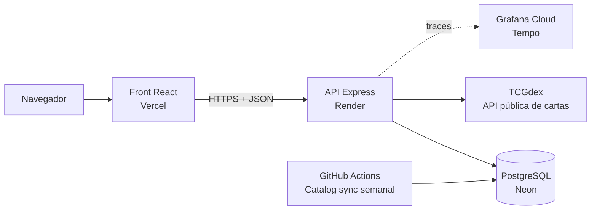
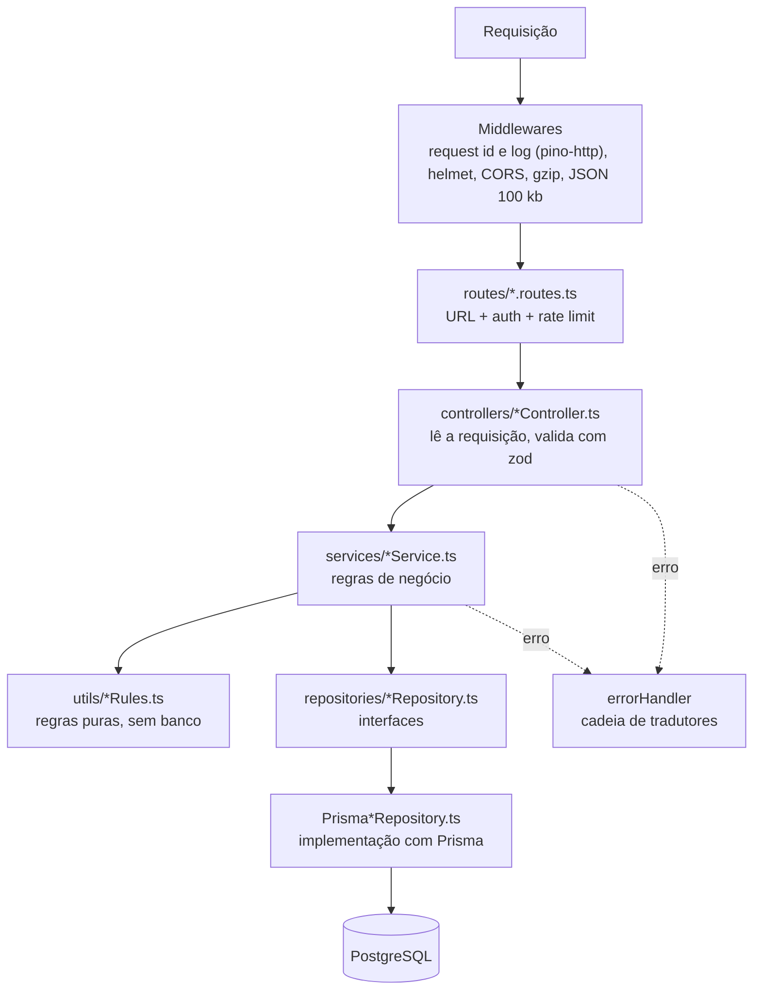

# Arquitetura, POO e SOLID

Como o PokeBox está montado e onde cada conceito da disciplina aparece no código. Os caminhos são relativos à raiz do repositório.

## Visão geral

O front só fala com a nossa API. A API guarda no banco tudo o que precisa das cartas (catálogo local e detalhe), então a TCGdex só é chamada quando falta algo ou para atualizar uma cópia antiga.

## Camadas do backend

- Quem dá `new` nas classes é só a raiz de composição: `backend/src/container.ts` cria a infraestrutura e cada `backend/src/modules/*.module.ts` monta um módulo (rotas, controller, service e repositórios).
- Toda resposta segue o mesmo contrato: `{ success: true, data }` ou `{ success: false, error, details }`.
- O `errorHandler` (`backend/src/middlewares/errorHandler.ts`) passa o erro por uma lista de tradutores: corpo inválido, zod (400), `AppError` (o status do erro), Prisma (409 ou 422) e TCGdex (502 ou 504). O que nenhum reconhece vira 500.

## POO no código

| Conceito | Onde | O que mostra |
|---|---|---|
| Classes com estado e comportamento | `backend/src/services/OfferService.ts`, `TradeService.ts`, `middlewares/AuthMiddleware.ts` | Cada classe recebe as dependências no construtor e guarda só o que usa |
| Encapsulamento | `backend/src/cards/catalog/DbCachedCatalog.ts` e `InFlightDedupCatalog.ts` | Mapas internos `private readonly` que ninguém de fora altera |
| Herança | `backend/src/errors/AppError.ts` e `errors/domainErrors.ts` | `NotFoundError`, `ForbiddenError`, `ConflictError` e `UnprocessableError` estendem `AppError` e fixam o status |
| Polimorfismo | `backend/src/errors/translators/` e `backend/src/cards/catalog/` | Cinco tradutores com a mesma interface `ErrorTranslator`; seis catálogos com a mesma interface `CardCatalog` |
| POO no front | `frontend/src/auth/authService.js`, `createAuthService.js` | `AuthService` com gateway HTTP, armazenamento do token e validador injetados; avisa a tela quando a sessão muda (Observer) |

## SOLID com exemplos

| Princípio | Exemplo | Onde |
|---|---|---|
| S: uma responsabilidade por unidade | As regras de oferta, troca e anúncio são funções puras: recebem os dados e dizem se a ação pode acontecer. O service busca os dados e grava. | `backend/src/utils/offerRules.ts`, `tradeRules.ts`, `listingRules.ts` |
| S | Abrir uma troca saiu do service de ofertas para uma classe própria | `backend/src/services/TradeOpener.ts` |
| O: aberto para extensão, fechado para mudança | Erro novo é um tradutor novo na lista; o `errorHandler` não muda | `backend/src/container.ts` (lista), `middlewares/errorHandler.ts` |
| O | Cache, deduplicação e leitura do banco entram embrulhando o catálogo, sem mexer no cliente da TCGdex | `backend/src/modules/cards.module.ts` |
| L: substituição | Qualquer `CardCatalog` fica no lugar de outro. Com `USE_MOCK=true`, o `MockCatalog` substitui a pilha inteira e o `CardService` não percebe | `backend/src/cards/catalog/CardCatalog.ts`, `MockCatalog.ts` |
| L | Qualquer subclasse de `AppError` gera a resposta certa sem código especial | `backend/src/errors/domainErrors.ts`, `errors/translators/AppErrorTranslator.ts` |
| I: interfaces pequenas | O `WishlistService` recebe só a leitura de donos e de quantidade da coleção, não o repositório inteiro | `backend/src/services/WishlistService.ts`, `repositories/CollectionRepository.ts` |
| I | Dentro da transação, cada repositório aparece só com as operações permitidas | `backend/src/repositories/UnitOfWork.ts` |
| D: depender de abstrações | O `AuthService` conhece `PasswordHasher` e `TokenSigner`; bcrypt e JWT entram pelo construtor | `backend/src/services/AuthService.ts`, `security/` |
| D | Services recebem interfaces; só o container conhece as classes concretas | `backend/src/container.ts`, `modules/trading.module.ts` |
| D no front | O teste do `AuthService` passa versões falsas do gateway e do armazenamento | `frontend/src/auth/authService.test.js` |

A injeção de dependência é manual, sem framework. Ferramentas como tsyringe e inversify exigem decorators e `reflect-metadata` e escondem de onde vem cada dependência, sem ganho num backend deste tamanho.

## Padrões de projeto

| Padrão | Onde | Para quê |
|---|---|---|
| Decorator | `backend/src/cards/catalog/`: `LocalFirstCatalog` → `MemoryCachedCatalog` → `InFlightDedupCatalog` → `DbCachedCatalog` → `TcgdexClient` | Cada camada acrescenta um comportamento (banco primeiro, memória por 1 h, junta pedidos iguais, cópia no banco atualizada por trás depois de 24 h, HTTP) |
| Repository | `backend/src/repositories/` | Interface `<Nome>Repository` e implementação `Prisma<Nome>Repository`; o service não conhece o Prisma |
| Unit of Work | `PrismaUnitOfWorkFactory` em `backend/src/repositories/` | Ofertas, trocas e desativação de conta recebem todos os repositórios dentro da mesma transação (RN-07) |
| Chain of Responsibility | `backend/src/errors/translators/` | O tratador tenta cada tradutor em ordem |
| Strategy | `PasswordHasher` (bcrypt) e `TokenSigner` (JWT) em `backend/src/security/` | Trocar a biblioteca sem mexer no `AuthService` |
| Composition Root | `backend/src/container.ts` | Um lugar só monta o grafo de objetos |
| Plano B (fallback) | `LocalCatalogFinder` → `SmartCardFinder` em `backend/src/cards/search/` | Busca no catálogo local e, se ele não tiver a carta, na TCGdex |
| Factory e Observer no front | `frontend/src/auth/createAuthService.js`, `authService.js` | Montar o serviço com as dependências e avisar a tela quando a sessão muda |

## Pontos fracos conhecidos

Ficam registrados para a próxima rodada de refatoração:

- O `AuthMiddleware` verifica o JWT com a biblioteca direto (`backend/src/middlewares/AuthMiddleware.ts`); só a assinatura passa pela abstração `TokenSigner`.
- Alguns services ainda lançam `AppError` com status HTTP fixo em vez das subclasses de domínio (ex.: `WishlistService.ts`, `CardService.ts`).
- As interfaces de repositório usam tipos do Prisma, e alguns services recebem a transação do Prisma (`Db`). Trocar de ORM mexeria nos services.
- `repositories/UnitOfWork.ts` importa `ListingChangeApplier` de `services/`, ou seja, uma dependência no sentido contrário das camadas.
- A validação com zod é middleware nas rotas de cartas e chamada dentro do controller nas outras.
- `utils/tradeRules.ts` (334 linhas) e `utils/offerRules.ts` (238) juntam validação e montagem da resposta.
