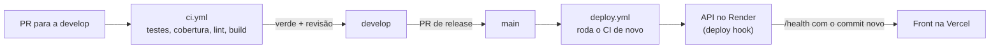

# Deploy

Por que Vercel, Render e Neon: [decisão 0008](decisoes/0008-deploy.md).



| Peça | Onde | Como chega lá |
|---|---|---|
| Banco PostgreSQL | Neon | as migrations rodam sozinhas quando a API sobe; o seed roda uma vez, à mão; o catálogo da busca roda uma vez à mão depois do deploy e toda semana pelo GitHub Actions |
| API | Render, com o Dockerfile de `backend/` (estágio `prod`) | o pipeline chama o deploy hook do Render |
| Front | Vercel, pasta `frontend/` | o pipeline publica com a CLI da Vercel |

O app está no ar:

- Site: https://poke-box-gt.vercel.app
- API: https://pokebox-api.onrender.com (Swagger em [`/docs`](https://pokebox-api.onrender.com/docs))

Para entrar, use os usuários do seed; a senha de demonstração é passada a quem for avaliar fora do GitHub.

O caminho de uma mudança até a produção:

```
PR para a develop  ->  CI (testes)  ->  merge
release develop -> main  ->  Deploy: CI de novo  ->  API no Render  ->  front na Vercel
```

O workflow `.github/workflows/deploy.yml` roda a cada push na `main` e também pode ser disparado à mão na aba Actions. Se algum teste falhar, nada é publicado. Ele só publica o front depois que o `/health` da API responde com o commit novo (`data.version`), para o front nunca chegar antes da API de que precisa.

Configuração de produção no código:

- `backend/Dockerfile` tem dois estágios. O `dev` instala tudo e compila; o `prod` copia só o resultado e as dependências de produção, roda como `node` e tem `HEALTHCHECK`. O Render usa o último, o `prod`.
- `frontend/Dockerfile` tem o estágio `dev` (Vite), o `build` (gera `dist/`) e o `prod` (nginx com `frontend/nginx.conf`). A Vercel não usa Docker; o nginx serve para o modo produção local.
- `frontend/vercel.json` manda qualquer caminho para o `index.html`, para o F5 em `/colecao` não dar 404, e desliga o deploy automático da Vercel na `main`, que passa a ser feito pelo pipeline.
- A API aceita chamadas do navegador só dos sites em `CORS_ORIGIN` ou dos que batem com `CORS_ORIGIN_REGEX` (os previews da Vercel).

Catálogo da busca em produção (#78):

- Uma vez, depois do deploy que traz a tabela `CatalogCard`, da sua máquina: `cd backend && DATABASE_URL="<URL do Neon>" npm run catalog:sync`. Para trazer o português (#157) sem refazer o inglês: `npm run catalog:sync -- pt`. Depois do deploy da #158 (migration `catalog_filtros`), rodar o sync completo de novo para preencher sets, filtros e o tipo, a raridade e a categoria das cartas. Depois do deploy da #192, rodar o sync de novo para guardar o detalhe de todas as cartas. O melhor é disparar o workflow (Actions > Catalog sync > Run workflow, na `main`): ele roda perto do Neon, cabe no limite de 120 min e não precisa da URL do banco no terminal; se ninguém disparar, o agendamento de segunda faz a carga completa sozinho. A partir daí, o workflow semanal só busca o detalhe das cartas novas. Como o seed, o script não roda dentro da imagem de produção, que não tem o `tsx`.
- Depois, o workflow `.github/workflows/catalog-sync.yml` roda o mesmo script toda segunda às 06:00 UTC (e à mão, em Actions > Catalog sync > Run workflow, escolhendo a `main`). Ele usa o secret `DATABASE_URL` do environment `production`, com a URL do Neon. Sets novos saem poucas vezes por ano, então uma vez por semana basta; se o GitHub atrasar ou pular um agendamento, nada quebra, a busca só demora mais para ver o set novo.
