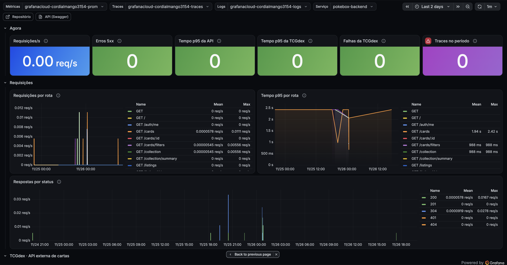
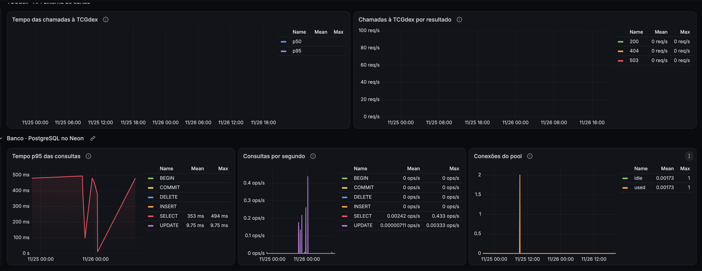
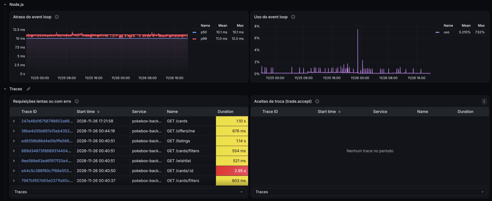
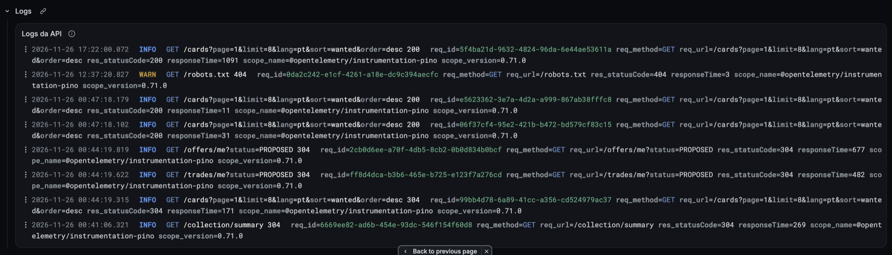

# Logs, traces e performance

Decisões e números resumidos: [decisão sobre observabilidade e performance](decisoes/0010-observabilidade-e-performance.md).

## Logs e saúde da API

A API registra uma linha por requisição com o [pino](https://getpino.io): método, rota, status, tempo de resposta (`responseTime`, em ms) e um id da requisição (`reqId`). Um erro de servidor (5xx) sai nessa mesma linha, com o stack. Senha, token e o header `Authorization` aparecem como `[oculto]`.

| Onde | Formato | Como ver |
|---|---|---|
| `npm run dev` ou `docker compose up` | colorido, uma linha por evento | o próprio terminal, ou `docker compose logs -f tcg-backend` |
| Produção (Render) e `make prod-up` | JSON, uma linha por evento | aba *Logs* do serviço no Render, ou `make prod-logs` |

`LOG_LEVEL` muda o quanto aparece (`debug` mostra mais, `warn` só avisos e erros). Nos testes o padrão é `silent`.

Toda resposta traz o header `x-request-id`, e o front consegue lê-lo (está liberado no CORS). Se quem chama já manda esse header, a API usa o mesmo id; senão, gera um.

**Como investigar um erro em produção:**

1. A pessoa conta o que fez e, se der, o `x-request-id` da resposta (na aba Network do navegador).
2. No Render, aba *Logs*, busque o id (`3f2a...`) e veja tudo o que aconteceu naquela requisição, inclusive o stack do erro.
3. Sem o id, busque `"statusCode":500` para ver os erros de servidor, ou ordene pelo `responseTime` para achar as rotas lentas.

Duas rotas dizem se a API está bem:

| Rota | Confere | Quem usa |
|---|---|---|
| `GET /health` | o processo está de pé (não toca no banco); devolve o commit em `version` | Health Check do Render, o pipeline de deploy e o monitor externo (UptimeRobot, a cada 5 min) |
| `GET /health/ready` | o banco responde (`SELECT 1`); 503 se não | para conferir à mão ou num monitor externo |

As duas ficam fora do log automático, porque o Render, o pipeline e o monitor chamam o tempo todo. O preflight do CORS (`OPTIONS`, que o navegador manda antes de cada `POST`) também fica fora.

## Traces

Um trace é a linha do tempo de uma requisição: quanto tempo ela passou no Express, em cada consulta ao banco e na chamada à TCGdex. O log diz *que* uma rota demorou; o trace diz *onde*. A API usa o [OpenTelemetry](https://opentelemetry.io), o padrão aberto: o mesmo código manda os traces para o Jaeger local ou para qualquer serviço compatível, trocando só variáveis de ambiente.

```bash
make traces
```

`make traces` sobe o [Jaeger](https://www.jaegertracing.io) (perfil `observabilidade` do compose) e a API em modo watch mandando os traces para ele. A tela fica em http://localhost:16686: escolha o serviço `pokebox-backend` e a operação.

| O que aparece | De onde vem |
|---|---|
| a requisição (`POST /trades/:id/accept`) e o handler da rota | instrumentação de HTTP e do Express |
| cada operação do Prisma e cada SQL, com o texto da consulta | `@prisma/instrumentation` e instrumentação do `pg` |
| a chamada à TCGdex (`GET`) | instrumentação do `fetch` (undici) |
| `trade.accept`, em volta do aceite da troca | span manual (`withSpan`, em `src/lib/tracing.ts`) |

Como funciona:

- `src/instrumentation.ts` liga o OpenTelemetry e precisa carregar **antes** do Express e do `pg`, para conseguir "embrulhar" essas bibliotecas. Por isso ele entra com `node --import` (no `npm run dev`, no `npm start` e no `CMD` do Dockerfile), e não por um `import` no `server.ts`.
- Sem `OTEL_EXPORTER_OTLP_ENDPOINT`, nada liga: os testes e quem não quer traces não são afetados.
- O `/health` não gera trace (o monitor chama a cada 5 minutos), e os spans de middleware ficaram de fora para o trace mostrar só o que importa.
- Com os traces ligados, cada linha de log ganha `trace_id` e `span_id`. Achou um erro no log? Copie o `trace_id` e cole na busca do Jaeger para ver a requisição inteira.

**Roteiro para a apresentação:** com `make traces`, `ash` aceita a oferta da `misty` (a troca nasce), a `misty` confirma o recebimento e o `ash` confirma também (a segunda confirmação conclui). No Jaeger, a operação `trade.accept` da segunda confirmação mostra a transação (`BEGIN` ... `COMMIT`), as travas `SELECT ... FOR UPDATE` da RN-08 em ordem e o tempo de cada consulta. Depois, abra um `GET /cards/:id` de uma carta nunca vista (span da TCGdex, centenas de ms) e o mesmo id de novo (sai do cache em memória, sem span da TCGdex).

Na mão, sem o `make`: com o Jaeger de pé, rode a API com `OTEL_EXPORTER_OTLP_ENDPOINT=http://localhost:4318` (ou `http://jaeger:4318` com o backend no compose). Os traces vão em protobuf por HTTP (OTLP), formato que o Jaeger e o Grafana aceitam.

### Traces da produção (Grafana Cloud)

A API no Render manda os traces para o Grafana Cloud (plano gratuito, retenção curta). Para ver: no Grafana, **Explore**, fonte **Tempo**, e busque `{resource.service.name="pokebox-backend"}`, ou cole um `trace_id` copiado dos logs do Render.

Configuração:

1. No Grafana Cloud, **Connections → OpenTelemetry (OTLP)**: gera o endpoint e um token.
2. No Render, serviço da API, **Environment**:

| Variável | Valor |
|---|---|
| `OTEL_EXPORTER_OTLP_ENDPOINT` | o endpoint do Grafana (`https://otlp-gateway-prod-<região>.grafana.net/otlp`) |
| `OTEL_EXPORTER_OTLP_HEADERS` | `Authorization=Basic <token>`. É segredo: só no painel do Render, nunca no Git |
| `OTEL_SERVICE_NAME` | `pokebox-backend` |

Sem essas variáveis, a API roda sem traces. Os traces saem em lotes a cada poucos segundos e, ao desligar, a API espera o último lote ser enviado.

### Painel do Grafana Cloud (produção)

No Grafana Cloud, um painel junta num lugar só as métricas, os traces e os logs que a API em produção manda pela mesma conexão OTLP, filtrados pelo serviço `pokebox-backend`. Os prints abaixo são de 26/11/2026, com o período dos últimos 2 dias. O tráfego é baixo porque o app não tem uso real fora da avaliação.

**Requisições.** No topo, o resumo do momento: requisições por segundo, erros 5xx, tempo p95 da API e da TCGdex, falhas da TCGdex e traces no período. Embaixo, as requisições e o tempo p95 por rota, e as respostas por status (200, 304, 401, 404). O `GET /cards` aparece como a rota mais lenta, perto de 2 s no p95.



**TCGdex e banco.** O tempo e o resultado das chamadas à TCGdex: os gráficos ficaram vazios, porque a API não chamou a TCGdex no período. Do PostgreSQL no Neon: o tempo p95 de cada tipo de consulta (`SELECT` perto de 350 ms em média), as consultas por segundo e as conexões do pool.



**Node.js e traces.** O atraso e o uso do event loop (p99 perto de 11 ms e uso abaixo de 8%: a API não fica travada). Embaixo, as requisições lentas ou com erro, com o link para o trace de cada uma (a mais lenta foi um `GET /cards/:id` de 2,95 s), e os traces do aceite de troca (`trade.accept`), sem nenhum no período.



**Logs.** As linhas de log da API, com o `req_id` de cada requisição, o status e o tempo de resposta. O mesmo `req_id` volta no cabeçalho `x-request-id`, então dá para ir de uma resposta ao log dela.



## Performance e segurança

### O que já existia

- Cache das cartas da TCGdex em camadas (padrão Decorator, em `backend/src/cards/catalog/`): memória (1 h, até 500 cartas), depois junção de pedidos iguais em andamento, depois a tabela `CardCache` no banco (responde sempre que tem a carta; passadas 24 h, a cópia é atualizada por trás, sem o usuário esperar), e só então a chamada HTTP.
- Cache em memória da busca de cartas (10 min) e da lista de sets (1 dia), e timeout de 8 s nas chamadas à TCGdex.
- A TCGdex falha por alguns segundos com frequência (#145). Quando ela responde 502, 503 ou 504, ou a conexão cai, a API tenta de novo até 2 vezes (espera de 200 ms e 600 ms, sem passar dos 8 s do timeout); 404, outros erros e timeout não são repetidos. Cada nova tentativa aparece no log (`warn`) e como span próprio nos traces. Se mesmo assim ela não responder, a busca, a lista de sets, os filtros e as cartas de um set usam o último resultado guardado em memória, mesmo vencido. Nos idiomas sincronizados (`en` e `pt`), a lista de sets, os filtros e todas as buscas já saem do banco (#158) e não dependem dessa memória.
- `Cache-Control` nas cartas: a lista é `public, max-age=300` (os rankings `wanted` e `traded`, `public, no-cache`); os filtros, `public, max-age=3600`; o detalhe é `private` (`max-age=60` sem login, `no-cache` com login), porque traz os anúncios da carta e, com login, os dados da pessoa.
- Paginação, busca e filtros no `GET /listings`.

### O que a #112 acrescentou

| O quê | Por quê |
|---|---|
| Compressão gzip (`compression`) | listas de cartas em JSON encolhem até 87% (tabela abaixo). Faz diferença no celular e na rede entre o Render e o navegador |
| Cabeçalhos de segurança (`helmet`) | `X-Content-Type-Options`, `Strict-Transport-Security`, política de conteúdo e outros; tira o `X-Powered-By: Express`. O Swagger em `/docs` continua funcionando |
| Limite de tentativas no login e no cadastro (`express-rate-limit`) | 20 tentativas **sem sucesso** para o mesmo e-mail a partir do mesmo IP, a cada 15 minutos, contadas à parte em cada rota. Depois disso, 429 com `Retry-After` |
| `trust proxy` em produção | no Render a API fica atrás de um proxy; sem isso, todo mundo pareceria ter o mesmo IP |
| `express.json({ limit: '100kb' })` | o limite já existia (padrão do Express), agora está escrito; acima dele, 413 |
| Índice `(status, createdAt DESC, id)` em `Listing` | o `GET /listings` lê os anúncios ativos já na ordem e para no fim da página |

Sobre o limite de tentativas:
- Conta só o que falha, e por IP **e** e-mail. Na apresentação, a turma inteira entra do mesmo wi-fi, ou seja, do mesmo IP. Se o limite fosse só por IP, 20 senhas erradas de pessoas diferentes travariam o login de todo mundo. Assim, quem erra a própria senha bloqueia só a própria conta, e quem tenta adivinhar a senha de alguém para em 20 tentativas.
- Depois do bloqueio, nem a senha certa entra naquele e-mail, a partir daquele IP, até a janela acabar: é o que impede a força bruta.
- Login e cadastro têm contadores separados: errar o cadastro não bloqueia o login.
- `AUTH_RATE_LIMIT` muda o número (padrão 20; `0` desliga).
- Risco que fica: a mesma senha testada em muitos e-mails diferentes não é barrada, porque cada e-mail tem o próprio contador. É o preço de não travar a sala inteira. O próximo passo seria um segundo limite só por IP, bem mais alto (por exemplo, 200 falhas em 15 minutos).
- O `trust proxy` confia em exatamente um proxy na frente da API, que é o caso do Render. Com outro proxy no meio (uma Cloudflare, por exemplo), a API passaria a enxergar o IP do proxy. Isso não abre brecha, porque a chave inclui o e-mail, mas precisa ser conferido com o app no ar (#60).

### Medição antes e depois

Máquina: Apple M4 Pro (12 núcleos), Node 24, Postgres 17 no Docker. API em modo produção (`NODE_ENV=production`, `LOG_LEVEL=warn`), aquecida com uma chamada antes de cada rota. Cada linha: `npx autocannon -c 20 -d 15 <url>` (20 conexões ao mesmo tempo, por 15 segundos). Latência média, p99 (99% das requisições ficam abaixo dele) e requisições por segundo.

**Com o banco do seed da época da #112 (10 cartas, poucos anúncios):**

| Rota | Antes | Depois |
|---|---|---|
| `GET /cards?name=pikachu` | 0,06 ms · p99 1 ms · 32.397 req/s | 0,09 ms · p99 1 ms · 27.515 req/s |
| `GET /cards/base1-4` | 3,15 ms · p99 5 ms · 5.621 req/s | 3,18 ms · p99 5 ms · 5.510 req/s |
| `GET /listings` | 3,23 ms · p99 6 ms · 5.411 req/s | 3,29 ms · p99 5 ms · 5.252 req/s |
| `GET /collection` (com login) | 4,28 ms · p99 7 ms · 4.235 req/s | 4,47 ms · p99 7 ms · 4.051 req/s |
| `GET /cards?name=pikachu&limit=100` pedindo gzip | 1,06 ms · p99 2 ms · 15.794 req/s | 1,22 ms · p99 3 ms · 11.120 req/s |

**Tamanho da resposta** (`curl -s -o /dev/null -w "%{size_download}" -H "Accept-Encoding: gzip" <url>`):

| Rota | Antes | Depois |
|---|---|---|
| `GET /cards?name=pikachu&limit=100` | 22.617 bytes | 2.828 bytes (−87%) |
| `GET /collection` do `ash` | 5.687 bytes | 1.254 bytes (−78%) |
| `GET /listings` | 2.075 bytes | 844 bytes (−59%) |

**Com 100 mil anúncios (20 mil ativos)**, gerados por `backend/scripts/bench-listings.sql` num banco de teste:

| Medida | Sem o índice novo | Com o índice novo |
|---|---|---|
| `GET /listings` (autocannon) | 23,79 ms · p99 42 ms · 823 req/s | 9,04 ms · p99 15 ms · 2.096 req/s |
| Consulta da primeira página (`EXPLAIN ANALYZE`) | 6,3 ms: lê os 20 mil ativos, ordena todos e pega 21 | 0,3 ms: lê 21 linhas do índice, já na ordem |

O log de SQL do Postgres estava ligado nas duas rodadas dessa última tabela, o que aumenta um pouco os números absolutos; a comparação vale porque as duas tiveram a mesma condição.

**Como ler esses números:**
- O índice é o ganho de verdade: 2,5 vezes mais requisições por segundo no `GET /listings` com volume de app em uso. A tabela do seed foi medida sem ele: com tão poucas linhas, o Postgres nem usaria o índice.
- A compressão encolhe muito as respostas, mas custa CPU. Na mesma máquina, sem rede no meio, isso aparece como menos requisições por segundo na lista grande (de 15.794 para 11.120). Pela internet o gargalo é a rede, e mandar 2,8 KB em vez de 22,6 KB compensa. Na escala do projeto, as duas folgas sobram.
- O helmet e a compressão custam de 2% a 15% de vazão nas rotas rápidas, diferença de microssegundos por requisição. É o preço dos cabeçalhos de segurança, e vale.

### Busca no catálogo local (#78)

A busca por nome passou a rodar no Postgres, numa tabela com o resumo das ~24 mil cartas, com as extensões `pg_trgm` (semelhança entre textos por trigramas, pedaços de 3 letras) e `unaccent` (tira acento). Trigrama no lugar do full-text search do Postgres (`tsvector`): o full-text é bom para frases e idiomas, mas não perdoa erro de digitação em nomes curtos como os das cartas. E no lugar de Elasticsearch ou Algolia: roda no banco que já temos, sem serviço novo, e funciona no plano grátis do Neon.

Medido com `EXPLAIN ANALYZE` no banco local com o catálogo inteiro (23.912 cartas):

| Consulta | Com o índice GIN | Sem índice |
|---|---|---|
| `charzard`, primeira página | 1,5 ms | 33,4 ms |
| `pikachu`, segunda página | 2,0 ms | 26,7 ms |
| a palavra `pipi` acha alguma carta? | 0,1 ms | 22,7 ms |

Pela API, na máquina local: `GET /cards?name=charizard base` responde em 5 a 10 ms. Antes da #157, a busca de `pikachu` em `lang=pt` ainda ia à TCGdex e levou 2 s na primeira chamada; hoje `en` e `pt` saem do banco, e só um idioma não sincronizado vai à TCGdex. Detalhes do índice em [`backend/docs/db.md`](../backend/docs/db.md#índice-de-trigramas-da-busca-78).

### Teste de carga em produção (24/11)

Um script simulou usuários navegando no site em produção (Render e Neon), cada um repetindo o caminho de quem usa o app (home, catálogo, busca, detalhe da carta, marketplace, anúncio, coleção, wishlist, propostas, trocas e perfil público) com 1 a 3 s entre um clique e outro. Só leitura, com uma checagem do `/health/ready` a cada 5 s.

Navegando, com os logins feitos antes, um de cada vez:

| Usuários ao mesmo tempo | Requisições | Erros | p50 | p95 | Máximo |
|---|---|---|---|---|---|
| 5 | 100 | 0 | 0,2 s | 0,6 s | 0,7 s |
| 20 | 498 | 0 | 0,2 s | 0,5 s | 1,4 s |
| 50 | 1.517 | 0 | 0,6 s | 2,1 s | 3,9 s |

O banco não falhou em nenhuma checagem (máximo de 0,9 s). As rotas mais lentas com 50 usuários foram `GET /listings` e `GET /offers/me` (p95 de 2,5 s e 2,4 s).

Com cada usuário fazendo login ao entrar (20 logins em poucos segundos), a API ficou lenta: o login teve p50 de 16,5 s, 4 de 25 passaram de 30 s, e as outras rotas chegaram a mais de 20 s no mesmo intervalo. O teste parou sozinho pela regra de segurança (p95 acima de 10 s), e a API voltou ao normal logo depois.

A causa é o bcrypt. A senha é conferida com custo 12 (`backend/src/modules/auth.module.ts`), e cada conferência ocupa a CPU pequena do plano gratuito do Render por cerca de 2 s. Os logins entram em fila e o resto da API espera a CPU. O banco não é o gargalo.

Como melhorar, se o uso crescer:

- Baixar o custo para 10 (o mínimo recomendado para bcrypt) deixa cada login umas 4 vezes mais rápido. As senhas já gravadas continuam no custo 12; para elas ganharem velocidade, a API precisaria recalcular o hash no próximo login.
- Um plano pago do Render, com mais CPU, resolve sem mexer no código.

### Decisões que ficaram como estão

- **O `requireAuth` consulta o banco a cada requisição.** Medido: o `GET /auth/admin-check` (JWT mais a busca do usuário pela chave) responde em 1,36 ms de média, contra 0,02 ms do `/health`. Confiar só no JWT economizaria essa consulta, mas uma conta desativada ou suspensa continuaria entrando até o token vencer (1 dia). Mantido: 1,3 ms é pouco para perder o bloqueio imediato.
- **O cache em memória some quando o Render dorme ou reinicia.** O cache no banco (`CardCache`) segura, e a TCGdex não é chamada de novo à toa. Com mais de uma instância, cada uma teria a própria memória; o próximo passo seria um Redis.
- **Loops com `await` dentro das transações de troca e oferta** (`TradeService`, `OfferService`, `lockInOrder` no `PrismaCollectionRepository`). São em sequência de propósito: as travas em ordem evitam deadlock (RN-08), e o tamanho é o número de cartas de uma troca. Não paralelizar.
- **Páginas muito fundas no `GET /listings`** ainda custam: com `OFFSET 1000`, a consulta leva 5,5 ms, porque o banco percorre as 1.000 linhas antes. Paginação por cursor resolveria; não vale agora.
- **Coleção, wishlist, ofertas e trocas:** paginação opcional desde a #77 (sem parâmetro, ainda devolvem a lista inteira por compatibilidade; o front já pede paginado desde a #174 e a #175).

### Como repetir

```bash
cd backend && npm run build
NODE_ENV=production LOG_LEVEL=warn npm start
npx autocannon -c 20 -d 15 "http://localhost:3000/listings"
```

Para o teste com volume, crie antes um banco **separado**. O script cria 5 mil usuários e 100 mil anúncios, e não há jeito fácil de desfazer num banco que você usa no dia a dia:

```bash
docker compose exec tcg-db createdb -U <user> pokebox_bench
cd backend
export DATABASE_URL="postgresql://<user>:<senha>@localhost:5432/pokebox_bench" PRISMA_DATABASE_URL="$DATABASE_URL"
npx prisma migrate deploy && npx prisma db seed
docker compose exec -T tcg-db psql -U <user> -d pokebox_bench < scripts/bench-listings.sql
NODE_ENV=production LOG_LEVEL=warn npm start
```

Para apagar depois: `docker compose exec tcg-db dropdb -U <user> pokebox_bench`.
