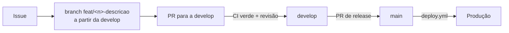

# Como o time trabalhou

Organização do board, do repositório e do fluxo de entrega. Números de 24/11/2026.

## Board

[Kanban no GitHub Projects](https://github.com/orgs/GeracaoBezerra/projects/1), com as colunas Backlog → Ready → In progress → In review → Done.

- Cada tarefa é uma issue com contexto, o que fazer, como testar, fora do escopo e "pronto quando".
- Labels de prioridade (`P0` para a entrega, `P1`, `P2 · pós-entrega`), de tamanho (`P` algumas horas, `M` um dia, `G` vários dias), de tipo (`melhoria`, `do zero`) e de área (Frontend, Backend, Testes, Infra/Deploy, Observabilidade, Banco de dados).
- Milestones: MVP (20/10) e Entrega 22/11.
- As issues que seguem abertas na entrega estão em [Limitações, dívidas e próximos passos](../README.md#limitações-dívidas-e-próximos-passos).

## Branches e pull requests

- Uma issue, uma branch, uma PR. A PR traz `Closes #<n>` e segue o template (`.github/pull_request_template.md`): o que muda, o que o revisor precisa saber, dependências, quebra de contrato, como testar e o que ficou pendente.
- Commits no padrão Conventional Commits em português, com o número da issue: `feat(trocas): aceitar a oferta cria a troca e as duas partes confirmam o recebimento (#213)`.
- 95 PRs mergeadas e 481 commits na `develop`. 17 releases `develop → main`.
- Toda PR atualiza a documentação (o README ou o arquivo de `docs/` do assunto) com o que traz de novo.

## Proteção das branches

`develop` e `main` têm a mesma regra no GitHub:

- checks obrigatórios `backend` e `frontend` (do `ci.yml`), com a branch em dia com a base;
- 1 aprovação, descartada quando chega commit novo;
- todas as conversas resolvidas antes do merge;
- sem force push e sem apagar a branch.

## Revisão de PR

Quem revisa roda o projeto antes de opinar: instala, roda lint, build e testes, sobe no Docker, testa a funcionalidade à mão com os usuários do seed e simula o merge com a `develop` para achar conflito. O resultado vai num comentário único na PR, com o que precisa mudar e o que é sugestão. As correções que nascem da revisão aparecem nos commits como `(revisão #221)`.

## GitHub Actions

| Workflow | Quando roda | O que faz |
|---|---|---|
| `ci.yml` | PR para `develop` ou `main` e push na `develop` | Backend: typecheck, build, testes de unidade e integração com PostgreSQL e cobertura mínima. Front: lint, testes com cobertura e build |
| `e2e.yml` | PR para `develop` ou `main` | Sobe tudo com Docker Compose e roda o Cypress; guarda prints e vídeos se falhar |
| `deploy.yml` | Push na `main` | Roda o CI, publica a API no Render, espera o `/health` responder com o commit novo e só então publica o front na Vercel |
| `catalog-sync.yml` | Segunda às 06:00 UTC e manual | Atualiza o catálogo de cartas no banco de produção |

## Docker Compose

- `docker-compose.yml`: banco, API e front em modo desenvolvimento, com healthcheck nos bancos e na API e ordem de subida (front espera a API, que espera o banco). Profiles opcionais para o banco de teste (`test`) e o Jaeger (`observabilidade`).
- `docker-compose.prod.yml`: sobrepõe o anterior com as imagens de produção (API sem dependências de desenvolvimento e com o usuário `node`, front compilado no nginx). `make prod-up` sobe esse modo.
- O `Makefile` junta os comandos do dia a dia: `make up`, `make test-int`, `make coverage`, `make e2e`, `make traces`, `make seed`.
